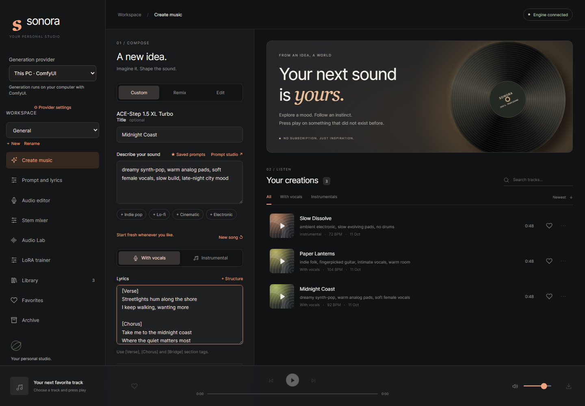
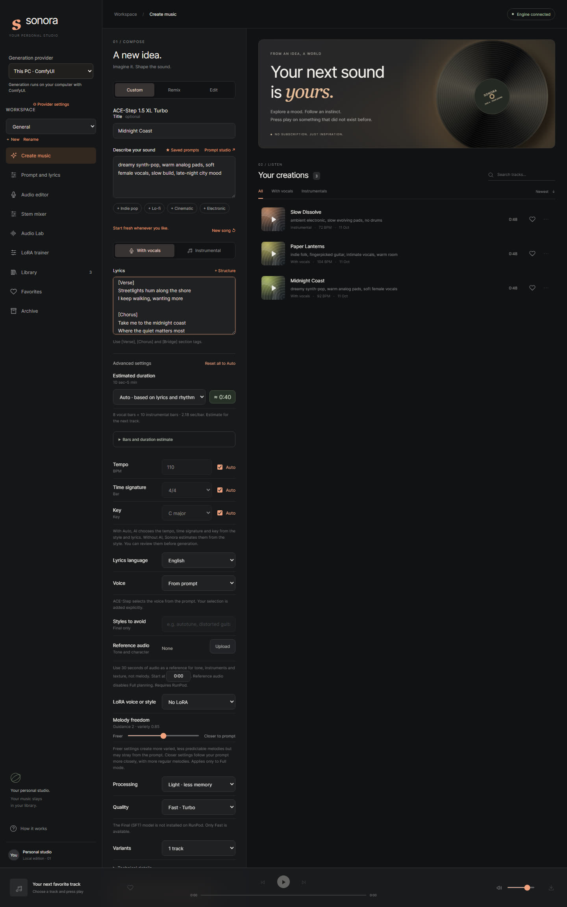
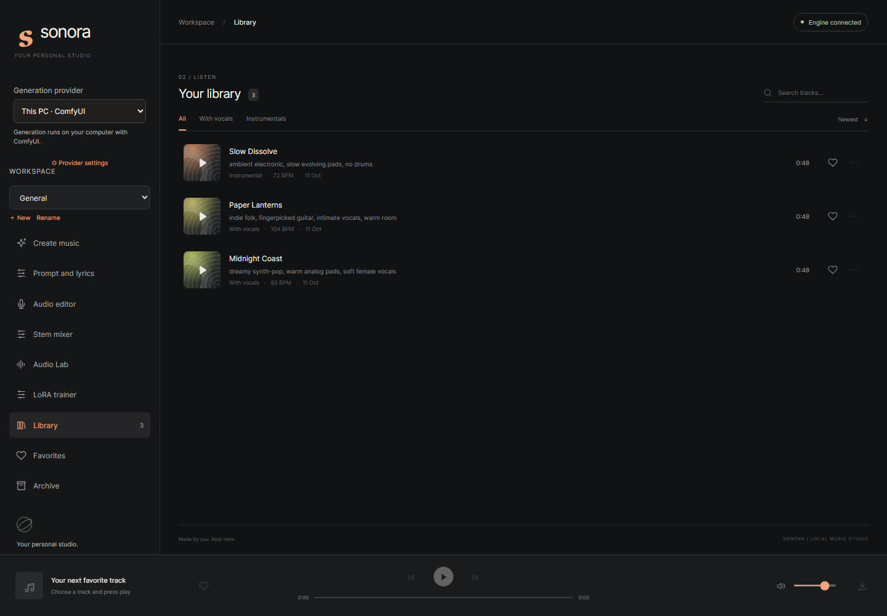
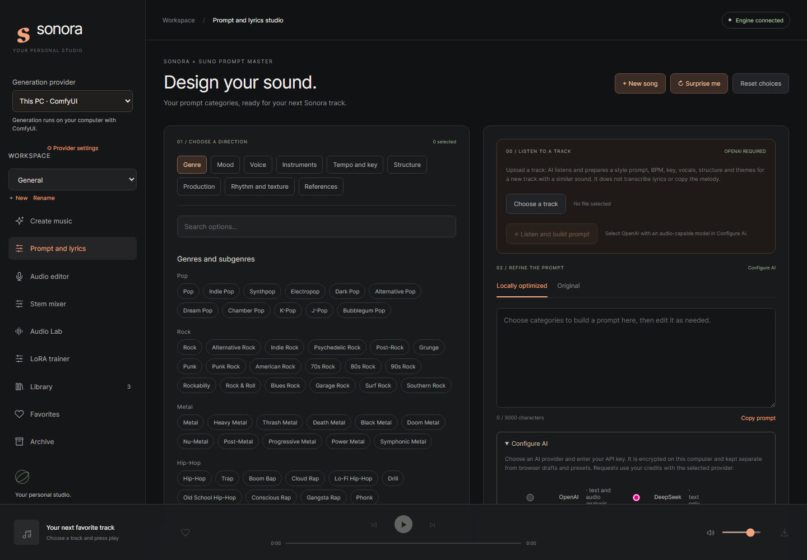

# Sonora Studio

Sonora Studio is a local-first music creation workspace built around ComfyUI and ACE-Step 1.5. It includes a music prompt composer, an audio library, editing and stem tools, an audio analysis and mastering workspace, and an optional RunPod LoRA trainer.

## Screenshots

Screenshots show demo tracks, not real generations.









## What you need

Sonora Studio is the control room, not a one-click installer. It needs a separate machine that actually runs the ACE-Step 1.5 model: either your own computer (ComfyUI) or a rented one (RunPod or Vast.ai). Pick one before you start.

### Minimum for running on your own computer

| | Minimum | Better |
|---|---|---|
| GPU | NVIDIA with **12 GB VRAM** (the model needs memory offloading and runs slowly) | **16 GB or more**; 20 GB+ avoids offloading |
| Free disk space | **22 GB** for the model files | 30 GB or more |
| System | Windows 10 or 11, or Linux | |
| Software | Node.js 22+, ComfyUI, FFmpeg | Python 3 with the packages in `separator-requirements.txt` (stem separation) |

The VRAM figures come from the [ACE-Step 1.5 model card](https://huggingface.co/ACE-Step/acestep-v15-xl-turbo) and release notes, not from our own measurements. They describe the ACE-Step project's own app; check your first generation in ComfyUI to see what your card really does. Without a suitable GPU, use RunPod (below) instead.

### What Sonora installs for you, and what it does not

| Sonora does it | You do it yourself |
|---|---|
| Checks which ACE-Step model files are missing and downloads them (about 19.9 GB, after you confirm), verifying each file's SHA-256 | Install **ComfyUI** (a recent version that includes the ACE-Step 1.5 nodes) and start it |
| Resumes an interrupted download | Install **Node.js 22+** |
| Tells you if a required ComfyUI node is missing | Install **FFmpeg** and make sure it is on your PATH (needed for uploads, editing, stems and export) |
| | Install the Python packages for stem separation (optional) |
| | Install NVIDIA drivers |

Sonora never installs or edits ComfyUI, its custom nodes or its settings.

New to ACE-Step 1.5? The project's own [tutorial and FAQ](https://github.com/ace-step/ACE-Step-1.5/blob/main/docs/en/Tutorial.md) explains how the model works, how to write prompts and lyrics, and answers common questions.

## Quick start (Windows, NVIDIA GPU)

This is the full path for running everything on your own computer. Do the steps in order. Linux works the same way with `npm start`.

### 1. Prepare the computer

- Update your NVIDIA driver from the NVIDIA website.
- Make sure you have at least 22 GB of free disk space (30 GB is more comfortable).
- Install **Node.js 22 or newer** (the LTS version) from [nodejs.org](https://nodejs.org).
- Install **FFmpeg**. In a Command Prompt run `winget install Gyan.FFmpeg`, then close and reopen the prompt so FFmpeg is found.

### 2. Install and start ComfyUI

- Download the **Windows portable (NVIDIA)** build from the Releases page of [ComfyUI](https://github.com/comfyanonymous/ComfyUI/releases) and extract it to a short path such as `C:\ComfyUI`.
- Start it with `run_nvidia_gpu.bat`. The first start takes a while. Keep that window open: ComfyUI must be running whenever you use Sonora.
- Use a recent ComfyUI that includes the ACE-Step 1.5 nodes. If the nodes are missing, Sonora tells you in **Provider settings**.

### 3. Get Sonora Studio

Click **Code, then Download ZIP** on GitHub and extract it, or clone it:

```sh
git clone https://github.com/barbarabax/sonora-studio.git
```

### 4. Start Sonora

Double-click `Avvia Sonora.cmd`, or run `npm start` in the Sonora folder. Your browser opens `http://127.0.0.1:3210`; if it does not, open that address yourself.

### 5. Connect Sonora to ComfyUI and download the models

1. Open **Provider settings** and check that the ComfyUI URL is `http://127.0.0.1:8188`.
2. Enter the ComfyUI folder that contains `main.py`. In the portable build this is the inner `ComfyUI` folder, for example `C:\ComfyUI\ComfyUI_windows_portable\ComfyUI`.
3. Choose **Check model files**. Sonora lists the exact missing ACE-Step files and their sizes.
4. Choose **Download missing models** and confirm. It downloads about 19.9 GB (18.5 GiB) for a fresh setup, shows progress, supports cancellation and resumes partial files when the host supports it. Every file is checked against the official Hugging Face SHA-256 before it is installed.
5. If ComfyUI still reports missing files afterwards, restart ComfyUI yourself.

### 6. Make your first song

Open **Create music**, write a style and lyrics, and press Create.

### Good to know

Sonora writes only the model weights into `ComfyUI/models/diffusion_models`, `models/text_encoders`, and `models/vae`. It does not install or edit ComfyUI, custom nodes, or settings. If ComfyUI still reports missing files after the download, restart ComfyUI yourself. The supported ACE-Step 1.5 XL Turbo files come from the [official Comfy-Org Hugging Face repository](https://huggingface.co/Comfy-Org/ace_step_1.5_ComfyUI_files); its model card lists Apache-2.0. Sonora does not bundle or redistribute those large model files.

Sonora listens on loopback only. It stores tracks, library metadata, prompt presets, provider settings, and encrypted provider credentials in `data/`. The folder is excluded from Git. Back it up separately if you want to keep generated audio and settings.

## Choose a generation provider

### This PC · ComfyUI

Start ComfyUI locally and select **This PC · ComfyUI**. The settings dialog accepts a loopback URL such as `http://127.0.0.1:8188`. Remote URLs are rejected for this option.

### RunPod · Serverless

Use this if your computer has no suitable GPU. **It is the longest setup path and it costs money**: RunPod bills your own account for GPU time and for the persistent storage volume. Nothing here is created for you. Read the steps through before you start.

RunPod needs a **custom Serverless worker**; a generic endpoint is not sufficient. This repository includes the worker script at `integrations/runpod/worker.py`, but does **not** publish a ready-to-deploy container image. You must build one that includes ComfyUI at `/comfyui`, the ACE-Step 1.5 ComfyUI nodes, Python and the RunPod Python SDK.

Checklist, in this order:

1. [ ] Create a RunPod account and add credit. Check the current [RunPod pricing](https://www.runpod.io/pricing).
2. [ ] Create a **network volume** of at least 25 GB (keep about 22 GB free for the models) in a data center that offers the GPUs you want. Mount path: `/runpod-volume`.
3. [ ] Build and deploy the custom worker image as a **Serverless endpoint** attached to that volume, in the same data center. Choose a GPU with 16 GB VRAM or more.
4. [ ] In the RunPod endpoint's test input, send `{"input":{"action":"setup"}}` once. The worker downloads the fixed official model list into the volume and checks sizes and SHA-256 hashes. The first download can take several minutes. You do not need to prepare a `SONORA_MODELS` variable.
5. [ ] Wait until the setup request completes and reports all four files. The weights stay on the volume for later requests.
6. [ ] In Sonora's **Provider settings**, enter the endpoint ID and your RunPod API key, tick **My endpoint and ACE-Step models are deployed and ready**, and choose **Verify and save RunPod**.
7. [ ] Select RunPod as the generation provider.

If a step is skipped, Sonora cannot do it for you: it only checks the key against the endpoint health route and reports what is missing.

The setup request runs a worker and uses compute; the persistent volume may incur storage charges while it remains allocated. RunPod bills your account directly. Check the current [RunPod pricing](https://www.runpod.io/pricing) before creating paid resources. Sonora checks the key against the endpoint health route before saving it. The app does not create or configure RunPod endpoints or volumes for you.

### Vast.ai · Existing instance

Open **Provider settings**, enter a Vast.ai API key, refresh the instance list, and select an already-running SSH-enabled instance. Add your computer's SSH public key to the instance and run ComfyUI on port `8188`; Sonora opens a local SSH tunnel to it. Install or enable the OpenSSH client if it is missing. Sonora reports missing ACE-Step nodes or models, but it does not send model files to the remote Vast disk; install those on the instance yourself.

This integration only lists instances and connects to the instance you select. It does not rent, create, start, stop, or destroy machines. Disconnecting Sonora leaves the instance running, so check Vast.ai and stop it there when you are finished to avoid ongoing charges.

### Credential handling

Provider API keys are sent to the local Sonora server, encrypted at rest with AES-256-GCM, and never included in browser responses. The local encryption key is stored under `data/` (or the path in `SONORA_SECRET_FILE`). Keep the Windows account or Linux data directory protected; local disk encryption and account security still matter. Never commit `data/`, share API keys, or put them in screenshots.

## Optional configuration

The application starts with built-in ACE-Step defaults. Copy `config.example.json` to `config.json` only if you need to change local model filenames or the listening port. `config.json` is ignored by Git. API keys should be entered in the app's provider settings, not in this file.

`SONORA_DATA_DIR` selects the private data folder. `SONORA_SECRET_FILE` selects the local encryption-key file. RunPod's optional expiry watchdog can be scheduled with the example systemd service and timer in `integrations/runpod/`; it reads the same encrypted credential store used by the app.

## Development

```sh
npm test
npm run check
```

`npm test` runs the Node test suite. `npm run check` parses the JavaScript source files without installing packages. The audio DSP parity check is available with `npm run test:audio` when Python and the project audio dependencies are installed.

## Privacy and project scope

Generated audio, provider keys, prompt AI credentials, and library metadata stay on the user's computer unless the user explicitly configures a remote provider or invokes an AI feature. RunPod and Vast.ai are third-party compute services and bill their account holder directly. The ComfyUI process and installation are managed separately from Sonora.

The prompt studio includes original prompt categories and presets from the author's separate Suno Prompt project. Sonora does not access or modify that installation.

## Support

Sonora Studio is a free gift to the community, provided as is and maintained in spare time. There is no guarantee of replies or fixes. Bug reports are welcome: please [open an issue](https://github.com/barbarabax/sonora-studio/issues/new/choose) and fill in the template (system, GPU, ComfyUI version, what happened). Check the Quick start and "What you need" above first, since most setup problems are covered there.

## About

Sonora Studio is made by Barbara Basso and Riccardo Abbate at [Barichord](https://barichord.com). Questions, feedback and bug reports are welcome: open an issue on GitHub, or write to [info@barichord.com](mailto:info@barichord.com).

Sonora Studio was built with AI assistance (Claude Code), so expect some rough edges.

## License

Sonora Studio is released under the [MIT License](LICENSE). Third-party components keep their own licenses; see below.

## Third-party notices

The Audio Lab mastering and analysis ideas include a rewritten portion of Barichord Audio Lab, licensed under the MIT License, Copyright (c) 2025 geeknik. See `THIRD_PARTY_NOTICES.md` for details and the included license text.
