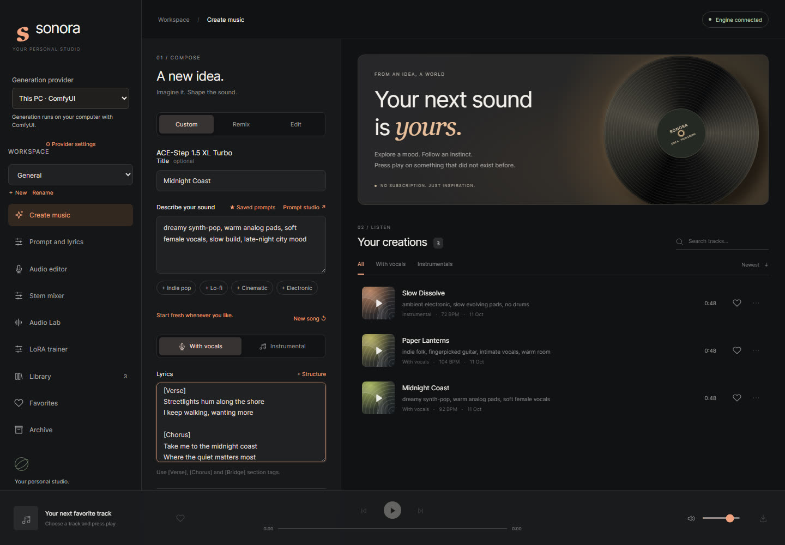
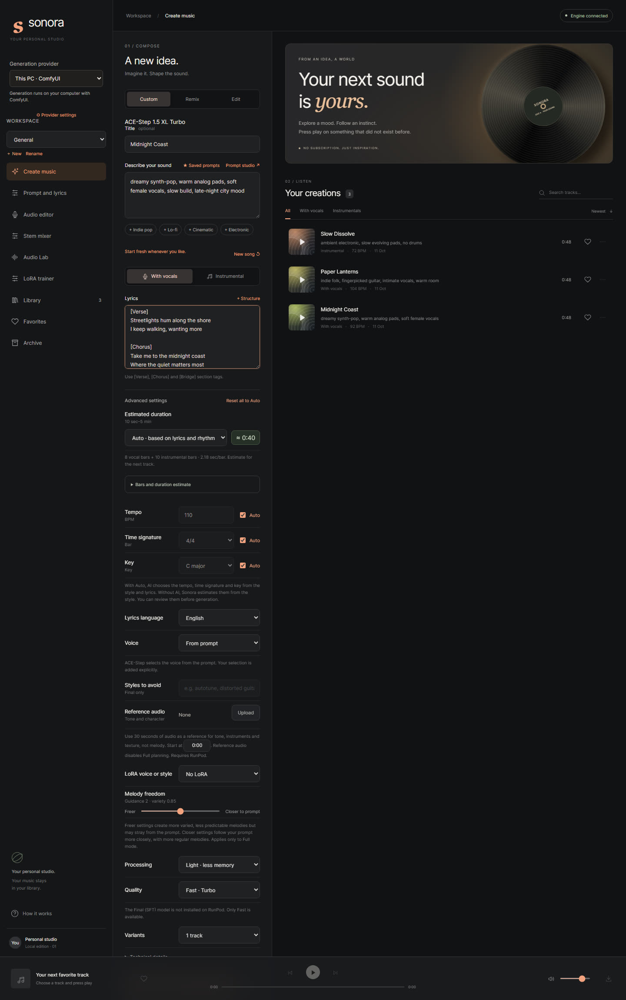
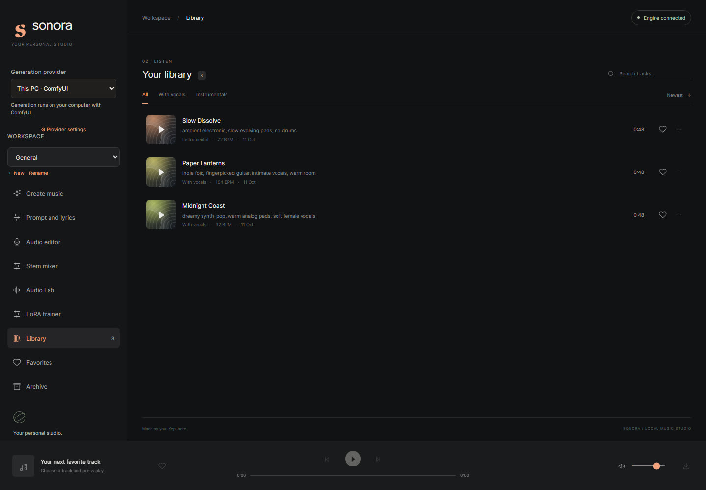
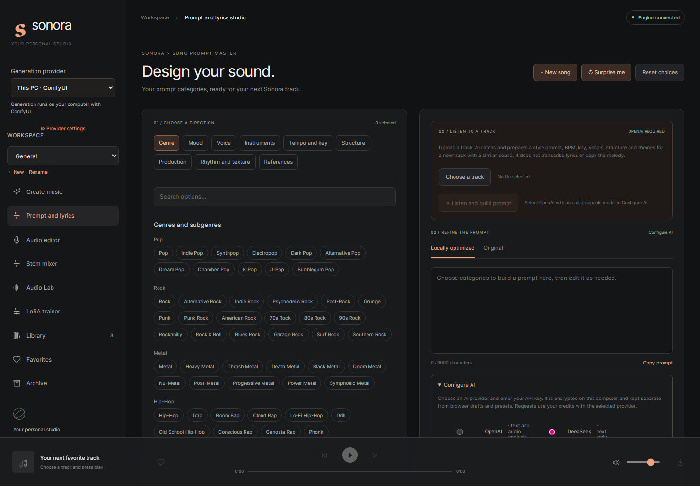

# Sonora Studio

Sonora Studio is a local-first music creation workspace. It makes songs with **ACE-Step 1.5** (through ComfyUI on your PC, RunPod or Vast.ai) and with **YuE2**, which writes the melody and chords first and then sings them. YuE2 can run **on your own PC with a light, quantised model (yue2.cpp, Q8_0), even on a 12 GB graphics card**. Sonora also includes a music prompt composer, an audio library, editing, stem and mixer tools, an audio analysis and mastering workspace, and an optional RunPod LoRA trainer.

## Screenshots

Screenshots show demo tracks, not real generations.









## What you need

Sonora Studio is the control room, not a one-click installer. It needs a separate machine that actually runs the ACE-Step 1.5 model: either your own computer (ComfyUI) or a rented one (RunPod or Vast.ai). Pick one before you start.

### Minimum for running on your own computer

| | Minimum | Better |
|---|---|---|
| GPU | NVIDIA with **12 GB VRAM** (the model needs memory offloading and runs slowly) | **16 GB or more**; 20 GB+ avoids offloading |
| Free disk space | **22 GB** for the model files | 30 GB or more |
| System | Windows 10 or 11, or Linux | |
| Software | Node.js 22+, ComfyUI, FFmpeg | Python 3 with the packages in `separator-requirements.txt` (stem separation) |

The VRAM figures come from the [ACE-Step 1.5 model card](https://huggingface.co/ACE-Step/acestep-v15-xl-turbo) and release notes, not from our own measurements. They describe the ACE-Step project's own app; check your first generation in ComfyUI to see what your card really does. Without a suitable GPU, use RunPod (below) instead.

### What Sonora installs for you, and what it does not

| Sonora does it | You do it yourself |
|---|---|
| Checks which ACE-Step model files are missing and downloads them (about 19.9 GB, after you confirm), verifying each file's SHA-256 | Install **ComfyUI** (a recent version that includes the ACE-Step 1.5 nodes) and start it |
| Resumes an interrupted download | Install **Node.js 22+** |
| Tells you if a required ComfyUI node is missing | Install **FFmpeg** and make sure it is on your PATH (needed for uploads, editing, stems and export) |
| | Install the Python packages for stem separation (optional) |
| | Install NVIDIA drivers |

Sonora never installs or edits ComfyUI, its custom nodes or its settings.

New to ACE-Step 1.5? The project's own [tutorial and FAQ](https://github.com/ace-step/ACE-Step-1.5/blob/main/docs/en/Tutorial.md) explains how the model works, how to write prompts and lyrics, and answers common questions.

## Easiest start: the portable Windows download

1. Download `Sonora-Studio-<version>-win-x64.zip` from the [Releases](https://github.com/barbarabax/sonora-studio/releases) page and extract it anywhere (a short path such as `C:Sonora` is best). Node.js is included; you do not install it.
2. Double-click **`Sonora.exe`**. Your browser opens Sonora Studio. Windows may warn that the program is from an unknown publisher because it is not signed: choose **More info**, then **Run anyway**.
3. Open **Provider settings**. The **Setup check** at the top lists what your computer has (Node.js, FFmpeg, NVIDIA card, ComfyUI, models) and what is still missing, with one hint for each.
4. For **YuE2 on your own PC**, use the **YuE2 · This PC** card: choose a folder and **Download missing files** (Sonora downloads the model files from Hugging Face and verifies their checksums), enter the engine program, then **Check and save** and restart. For **ACE-Step**, follow steps 5 and 6 of the guide below.

`Stop Sonora.cmd` stops the app. Your songs and settings stay in the `data` folder next to `Sonora.exe`: copy it to keep them when you update. If Sonora does not start, double-click `Sonora (show errors).cmd`. The download is built from this repository by a GitHub workflow (`.github/workflows/release.yml`), and its SHA-256 is published next to it.

Sonora never installs ComfyUI, FFmpeg, the NVIDIA driver or the yue2.cpp engine for you; the Setup check tells you what to do for each.

## Quick start (Windows, NVIDIA GPU, from the source code)

This is the full path for running everything on your own computer. Do the steps in order. Linux works the same way with `npm start`.

### 1. Prepare the computer

- Update your NVIDIA driver from the NVIDIA website.
- Make sure you have at least 22 GB of free disk space (30 GB is more comfortable).
- Install **Node.js 22 or newer** (the LTS version) from [nodejs.org](https://nodejs.org).
- Install **FFmpeg**. In a Command Prompt run `winget install Gyan.FFmpeg`, then close and reopen the prompt so FFmpeg is found.

### 2. Install and start ComfyUI

- Download the **Windows portable (NVIDIA)** build from the Releases page of [ComfyUI](https://github.com/comfyanonymous/ComfyUI/releases) and extract it to a short path such as `C:\ComfyUI`.
- Start it with `run_nvidia_gpu.bat`. The first start takes a while. Keep that window open: ComfyUI must be running whenever you use Sonora.
- Use a recent ComfyUI that includes the ACE-Step 1.5 nodes. If the nodes are missing, Sonora tells you in **Provider settings**.

### 3. Get Sonora Studio

Click **Code, then Download ZIP** on GitHub and extract it, or clone it:

```sh
git clone https://github.com/barbarabax/sonora-studio.git
```

### 4. Start Sonora

Double-click `Avvia Sonora.cmd`, or run `npm start` in the Sonora folder. Your browser opens `http://127.0.0.1:3210`; if it does not, open that address yourself.

### 5. Connect Sonora to ComfyUI and download the models

1. Open **Provider settings** and check that the ComfyUI URL is `http://127.0.0.1:8188`.
2. Enter the ComfyUI folder that contains `main.py`. In the portable build this is the inner `ComfyUI` folder, for example `C:\ComfyUI\ComfyUI_windows_portable\ComfyUI`. **ComfyUI Desktop** keeps its models elsewhere: enter its base folder (the one you chose when you installed it, the folder that contains `models`) instead.
3. Choose **Check model files**. Sonora lists the exact missing ACE-Step files and their sizes.
4. Choose **Download missing models** and confirm. It downloads about 19.9 GB (18.5 GiB) for a fresh setup, shows progress, supports cancellation and resumes partial files when the host supports it. Every file is checked against the official Hugging Face SHA-256 before it is installed.
5. If ComfyUI still reports missing files afterwards, restart ComfyUI yourself. If Sonora then shows a warning that ComfyUI does not see the files, you entered a folder ComfyUI does not read its models from: enter the base folder of your ComfyUI (for the desktop app, the one that contains `models`) and check again, or move the downloaded files into ComfyUI's own `models` folders.
6. Optional but recommended: choose **Run a quick test** in **Provider settings**. Sonora generates a hidden 10-second instrumental clip and tells you whether the whole pipeline runs (files, nodes, GPU memory), then deletes the clip. It confirms that things work, not how the music sounds.

### 6. Make your first song

Open **Create music**, write a style and lyrics, and press Create.

### Good to know

Sonora writes only the model weights into `ComfyUI/models/diffusion_models`, `models/text_encoders`, and `models/vae`. It does not install or edit ComfyUI, custom nodes, or settings. If ComfyUI still reports missing files after the download, restart ComfyUI yourself. The supported ACE-Step 1.5 XL Turbo files come from the [official Comfy-Org Hugging Face repository](https://huggingface.co/Comfy-Org/ace_step_1.5_ComfyUI_files); its model card lists Apache-2.0. Sonora does not bundle or redistribute those large model files.

Sonora listens on loopback only. It stores tracks, library metadata, prompt presets, provider settings, and encrypted provider credentials in `data/`. The folder is excluded from Git. Back it up separately if you want to keep generated audio and settings.

## YuE2: songs with melody and chords, on your own PC

YuE2 works in two steps. It first writes a **plan**: the sung melody and the chords, which you can see, play and change. Then it sings your lyrics over that plan. Choose **YuE2-3B · melody and chords** as the music model in **Create music**, then pick how the plan is made:

| Mode | What you decide |
|---|---|
| **Decide YuE2** | Style, lyrics and how freely the melody may vary. YuE2 invents melody and chords. |
| **I choose the chords** | The chord loops for verses, choruses and bridge, the key, tempo and meter, and the **song length** (Auto from the sung lines, or a target such as 3:00). Every variant uses the same plan. |
| **Reference** | Start from a song you upload (Sonora extracts its melody and chords) and let YuE2 sing it again in a new style. Use only audio you have the rights to. |

In **Advanced** you can import a MIDI file as the plan, listen to the plan, change single notes and chords, shorten parts, move the key, and download the plan as MIDI. **Yue2 adapters (LoRA)** lists ready-made YuE2 LoRA adapters you can install and combine (up to four); see the licence note below.

The song is as long as its plan. In *I choose the chords* the length comes from the lyrics (2 bars per sung line) or from the target you type.

### What you need on your own PC

| | Needed |
|---|---|
| GPU | NVIDIA with **12 GB VRAM**. The quantised `Q8_0` model is the light one; it was tested on an **RTX 2060 12 GB** |
| Free disk space | About **6.5 GB**: the engine (about 0.7 GB) and the model files (about 4.5 GB, plus 1 GB for covers) |
| System | Windows 10 or 11, or Linux (on both you build or obtain the engine yourself, see below) |
| Software | Node.js 22+, FFmpeg. No Python is needed to make songs |

On your own PC a song takes about as long as it lasts, and the graphics card stays busy meanwhile. Not tested on cards with less than 12 GB.

### Set it up

1. **Get the engine.** Sonora runs `yue-server` from [yue2.cpp](https://github.com/timoncool/yue2.cpp) (a fork of [ServeurpersoCom/yue2.cpp](https://github.com/ServeurpersoCom/yue2.cpp)). yue2.cpp publishes **no prebuilt binaries**: build it from source (on Windows with NVIDIA, run `buildcuda.cmd`; this needs the Visual C++ Build Tools and the CUDA Toolkit), or use an engine build that comes with another project such as [YuE2-Studio](https://github.com/timoncool/YuE2-Studio) if its release includes one. Sonora was tested with yue2.cpp commit `c8516db`.
2. **Download the model files.** The easy way is the **YuE2 · This PC** card in Provider settings: choose a folder, **Check model files**, **Download missing files**. Sonora downloads exactly these files from the Hugging Face repository [Serveurperso/YuE2-GGUF](https://huggingface.co/Serveurperso/YuE2-GGUF) into one folder:
   - `YuE2-3B-Q8_0.gguf` (3.8 GB): the song model
   - `YuE2-Vae-F32.gguf` (0.5 GB): the audio decoder
   - optional, only for the *Reference* mode: `SheetSage2-Q8_0.gguf` (0.1 GB) and `MERT-v2-FullSong-Q8_0.gguf` (0.9 GB)
3. Start Sonora and open **Provider settings → YuE2 · This PC (yue2.cpp)**. Enter the full path of the engine program (`yue-server`), the song model and the audio decoder. The model paths are filled in for you after the download. Add the transcriber and the LoRA folder if you use them. Choose **Check and save**: Sonora checks that every file exists. The paths are stored in `data/providers.json`.
4. **Restart Sonora.** The engine is started when Sonora starts.
5. In **Create music** choose **YuE2-3B · melody and chords**. **Where to create it** shows **This PC**.

If you prefer a file, put the same paths in `config.json`:

```json
{
  "yue2": {
    "cpp": {
      "engine": "C:\\yue2-cpp\\engine\\yue-server.exe",
      "model": "C:\\yue2-cpp\\models\\YuE2-3B-Q8_0.gguf",
      "vae": "C:\\yue2-cpp\\models\\YuE2-Vae-F32.gguf",
      "transcriber": "C:\\yue2-cpp\\models\\SheetSage2-Q8_0.gguf",
      "adapters": "C:\\yue2-cpp\\adapters"
    }
  }
}
```

`transcriber` and `adapters` are optional. The engine listens on `127.0.0.1` only, and finished songs are copied into your library with a checksum.

### YuE2 engine on another computer (for example Sonora on a server, engine on your home PC)

If Sonora runs on a server (a VPS) but your graphics card is at home, the engine can stay on your PC and be reached through an SSH tunnel. Nothing is exposed to the internet: the engine listens on `127.0.0.1` on your PC, and the tunnel makes it appear as `127.0.0.1` on the server.

1. **On your PC**, start the engine yourself (Sonora does not start it for you in this mode):

   ```sh
   yue-server --model YuE2-3B-Q8_0.gguf --vae YuE2-Vae-F32.gguf --host 127.0.0.1 --port 18087
   ```

2. **On your PC**, open the tunnel and keep it open (an SSH key is recommended; a scheduled task or `autossh` can keep it up):

   ```sh
   ssh -N -R 18087:127.0.0.1:18087 -o ServerAliveInterval=30 -o ExitOnForwardFailure=yes <user>@<server>
   ```

3. **In Sonora on the server**, open **Provider settings → YuE2 · This PC**, tick **The engine runs on another computer**, keep the port (18087) and choose **Check and save**, then restart Sonora. In `config.json` the same is `"yue2": { "cpp": { "remote": true, "port": 18087 } }`.
4. In **Create music** choose YuE2 and **This PC**. The **Setup check** shows whether the tunnel answers.

Good to know: the PC, the engine and the tunnel must all be running; a song takes about as long as it lasts, so the tunnel must stay up that long, and a song interrupted by a broken tunnel is not resent. LoRA adapters are not managed from the server in this mode: install them on the PC (`--adapters`) and start the engine with them.

### YuE2 on RunPod (optional, advanced)

You can also run YuE2 on a RunPod serverless endpoint of your own: enter its ID in the same **YuE2** card (the RunPod API key is the one from the RunPod card). The worker is `integrations/runpod/yue2_worker.py`, with `yue2_boot.sh` and `yue2_cpp_build.sh` to prepare the volume. As for ACE-Step, no ready-made container image is published and RunPod bills your own account.

### Licences and credits for YuE2

YuE2, its GGUF files and the LoRA adapters are **not part of this repository**: you download them from their authors. The adapter catalogue (`yue2-adapters.json`) lists each adapter's author and page. The adapter weights derive from YuE2-3B (CC BY-NC 4.0): check each author's page and the YuE2 licence before any commercial use.

## Choose a generation provider

### This PC · ComfyUI

Start ComfyUI locally and select **This PC · ComfyUI**. The settings dialog accepts a loopback URL such as `http://127.0.0.1:8188`. Remote URLs are rejected for this option.

### RunPod · Serverless

Use this if your computer has no suitable GPU. **It is the longest setup path and it costs money**: RunPod bills your own account for GPU time and for the persistent storage volume. Nothing here is created for you. Read the steps through before you start.

RunPod needs a **custom Serverless worker**; a generic endpoint is not sufficient. This repository includes the worker script at `integrations/runpod/worker.py`, but does **not** publish a ready-to-deploy container image. You must build one that includes ComfyUI at `/comfyui`, the ACE-Step 1.5 ComfyUI nodes, Python and the RunPod Python SDK.

Checklist, in this order:

1. [ ] Create a RunPod account and add credit. Check the current [RunPod pricing](https://www.runpod.io/pricing).
2. [ ] Create a **network volume** of at least 25 GB (keep about 22 GB free for the models) in a data center that offers the GPUs you want. Mount path: `/runpod-volume`.
3. [ ] Build and deploy the custom worker image as a **Serverless endpoint** attached to that volume, in the same data center. Choose a GPU with 16 GB VRAM or more.
4. [ ] In the RunPod endpoint's test input, send `{"input":{"action":"setup"}}` once. The worker downloads the fixed official model list into the volume and checks sizes and SHA-256 hashes. The first download can take several minutes. You do not need to prepare a `SONORA_MODELS` variable.
5. [ ] Wait until the setup request completes and reports all four files. The weights stay on the volume for later requests.
6. [ ] In Sonora's **Provider settings**, enter the endpoint ID and your RunPod API key, tick **My endpoint and ACE-Step models are deployed and ready**, and choose **Verify and save RunPod**.
7. [ ] Select RunPod as the generation provider.

If a step is skipped, Sonora cannot do it for you: it only checks the key against the endpoint health route and reports what is missing.

The setup request runs a worker and uses compute; the persistent volume may incur storage charges while it remains allocated. RunPod bills your account directly. Check the current [RunPod pricing](https://www.runpod.io/pricing) before creating paid resources. Sonora checks the key against the endpoint health route before saving it. The app does not create or configure RunPod endpoints or volumes for you.

### Vast.ai · Existing instance

Open **Provider settings**, enter a Vast.ai API key, refresh the instance list, and select an already-running SSH-enabled instance. Add your computer's SSH public key to the instance and run ComfyUI on port `8188`; Sonora opens a local SSH tunnel to it. Install or enable the OpenSSH client if it is missing. Sonora reports missing ACE-Step nodes or models, but it does not send model files to the remote Vast disk; install those on the instance yourself.

This integration only lists instances and connects to the instance you select. It does not rent, create, start, stop, or destroy machines. Disconnecting Sonora leaves the instance running, so check Vast.ai and stop it there when you are finished to avoid ongoing charges.

### Credential handling

Provider API keys are sent to the local Sonora server, encrypted at rest with AES-256-GCM, and never included in browser responses. The local encryption key is stored under `data/` (or the path in `SONORA_SECRET_FILE`). Keep the Windows account or Linux data directory protected; local disk encryption and account security still matter. Never commit `data/`, share API keys, or put them in screenshots.

## Optional: AI assistant (OpenAI)

Making music does **not** need any AI key. An OpenAI API key only unlocks writing and listening helpers. Without it Sonora still works; those features are simply unavailable or fall back to a simpler version.

| Feature | Without a key | With a key |
|---|---|---|
| Improve a style prompt, write lyrics (Prompt and lyrics) | Not available | Available |
| Dice: a full idea with title, style and lyrics | Fills in only the style | Available |
| Auto tempo, time signature and key | Sonora estimates them from the words of the style | The AI chooses them from style and lyrics |
| Mastering suggestions (Audio Lab) | Not available | Available |
| Listen to a track and build a matching prompt | Not available | Available, with an audio-capable model |

**How to add the key**

1. Open **Prompt and lyrics** and scroll to **Configure AI**.
2. Choose **OpenAI**.
3. Paste your API key and save. Sonora loads the models available for your key; pick one (choose an audio-capable model to use *Listen to a track*).

The key is encrypted on this computer and is never returned to the browser. Requests are billed to your own OpenAI account, so check OpenAI's pricing. Create your key on the OpenAI platform and never share it or put it in screenshots.

## Optional configuration

The application starts with built-in ACE-Step defaults. YuE2 settings are entered in **Provider settings** (see above); a `yue2` block in `config.json` works too. Copy `config.example.json` to `config.json` only if you need to change local model filenames or the listening port. `config.json` is ignored by Git. API keys should be entered in the app's provider settings, not in this file.

`SONORA_DATA_DIR` selects the private data folder. `SONORA_SECRET_FILE` selects the local encryption-key file. RunPod's optional expiry watchdog can be scheduled with the example systemd service and timer in `integrations/runpod/`; it reads the same encrypted credential store used by the app.

## Development

```sh
npm test
npm run check
```

`npm test` runs the Node test suite. `npm run check` parses the JavaScript source files without installing packages. The audio DSP parity check is available with `npm run test:audio` when Python and the project audio dependencies are installed.

## Privacy and project scope

Generated audio, provider keys, prompt AI credentials, and library metadata stay on the user's computer unless the user explicitly configures a remote provider or invokes an AI feature. RunPod and Vast.ai are third-party compute services and bill their account holder directly. The ComfyUI process and installation are managed separately from Sonora.

The prompt studio includes original prompt categories and presets from the author's separate Suno Prompt project. Sonora does not access or modify that installation.

## Support

Sonora Studio is a free gift to the community, provided as is and maintained in spare time. There is no guarantee of replies or fixes. Bug reports are welcome: please [open an issue](https://github.com/barbarabax/sonora-studio/issues/new/choose) and fill in the template (system, GPU, ComfyUI version, what happened). Check the Quick start and "What you need" above first, since most setup problems are covered there.

## About

Sonora Studio is made by Barbara Basso and Riccardo Abbate at [Barichord](https://barichord.com). Questions, feedback and bug reports are welcome: open an issue on GitHub, or write to [info@barichord.com](mailto:info@barichord.com).

Sonora Studio was built with AI assistance (Claude Code), so expect some rough edges.

## License

Sonora Studio is released under the [MIT License](LICENSE). Third-party components keep their own licenses; see below.

## Third-party notices

The Audio Lab mastering and analysis ideas include a rewritten portion of Barichord Audio Lab, licensed under the MIT License, Copyright (c) 2025 geeknik. See `THIRD_PARTY_NOTICES.md` for details and the included license text.
